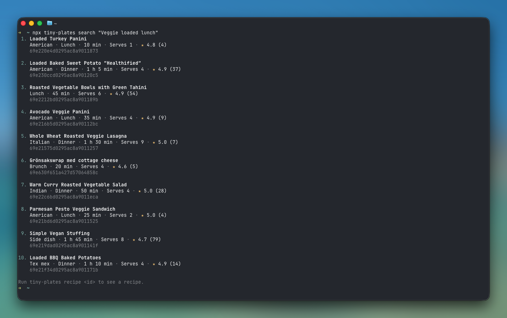

# tiny-plates

The JavaScript and TypeScript client for the [Tiny Plates](https://www.tinyplates.dev) recipe API. Search recipes, cook from what's in your pantry, scale recipes, build shopping lists and look up ingredients.

The package has two clients with the same methods and errors:

- A plain client that returns promises. It has no runtime dependencies and works in Node 20 or later, Bun, and anywhere else with `fetch`.
- An [Effect](https://effect.website) client, with typed errors per endpoint and responses checked against the schema.

It also has a `tiny-plates` command for the terminal. See [Command line](#command-line).

The package works with both `import` and `require`. The Effect client loads `effect`, which is ES module only, so using it from CommonJS needs Node 20.19 or later.

Read the [Tiny Plates docs](https://www.tinyplates.dev/docs) for what each endpoint returns and how filtering works.

## Get started

You need an API key. [Sign up](https://www.tinyplates.dev/sign-up) to create one. A free key comes with 50 requests a day. See [Authentication](https://www.tinyplates.dev/docs/authentication) for how keys work. The command line tool can also [sign in](#sign-in) in your browser instead.

Install the package:

```bash
npm install tiny-plates
```

Keep the key out of your code, for example in a `TINY_PLATES_API_KEY` environment variable. Then make your first request:

```ts
import { createClient } from 'tiny-plates'

const tinyPlates = createClient({ apiKey: process.env.TINY_PLATES_API_KEY ?? '' })

const { results } = await tinyPlates.search({ query: 'carbonara', limit: 5 })

for (const result of results) {
  console.log(result.title)
}
```

`createClient` throws if the key is empty, so a missing environment variable shows up straight away.

## What you can do

| Method | What it does | Docs |
| --- | --- | --- |
| `search({ query })` | Search recipes by text. | [Search recipes](https://www.tinyplates.dev/docs/api/search-recipes) |
| `popular.list()` | The most popular recipes. | [Popular recipes](https://www.tinyplates.dev/docs/api/popular-recipes) |
| `recipes.byId(id, { servings, units })` | One recipe, optionally scaled and converted to metric or imperial. | [Get a recipe](https://www.tinyplates.dev/docs/api/get-recipe) |
| `recipes.list(filters)` | Filter every recipe by cuisine, diet, time, nutrition and more. Business plan only. | [List recipes](https://www.tinyplates.dev/docs/api/list-recipes) |
| `pantry.list({ ingredients })` | Recipes ranked by how much of them your pantry covers. | [Cook from your pantry](https://www.tinyplates.dev/docs/api/pantry-recipes) |
| `shoppingList.build(recipes)` | One shopping list for several recipes, with each item in a category such as produce or dairy. | [Build a shopping list](https://www.tinyplates.dev/docs/api/shopping-list) |
| `substitutions.list(ingredients)` | What to use instead of an ingredient. | [Ingredient substitutions](https://www.tinyplates.dev/docs/api/substitutions) |
| `ingredients.resolve(names)` | Turn ingredient names, in any language, into ingredient ids. | [Resolve ingredient names](https://www.tinyplates.dev/docs/api/resolve-ingredients) |
| `ingredients.byId(id)` | One ingredient. | [Get an ingredient](https://www.tinyplates.dev/docs/api/get-ingredient) |
| `ingredients.pairings(id)` | Ingredients that go well with this one. | [Ingredient pairings](https://www.tinyplates.dev/docs/api/ingredient-pairings) |
| `ingredients.list()` | Every ingredient. Business plan only. | [List ingredients](https://www.tinyplates.dev/docs/api/list-ingredients) |
| `ingredients.vocabularies()` | The values you can filter on, such as cuisines, diets and allergens. | [Vocabularies](https://www.tinyplates.dev/docs/api/vocabularies) |
| `status.read()` | How many recipes and sites the catalogue has. | |
| `health.check()` | Whether the API is up. Needs no API key. | |

Lists, numbers and flags are typed. Pass `ingredients: ['egg', 'tomato']`, not a comma-separated string. Every response type is exported, so you can name them in your own code:

```ts
import type { Recipe } from 'tiny-plates'
```

## Examples

Scale a recipe for four people, in metric:

```ts
const { recipe } = await tinyPlates.recipes.byId('carbonara', { servings: 4, units: 'metric' })
```

Find what you can cook with what you have, missing at most one ingredient and without milk:

```ts
const { recipes } = await tinyPlates.pantry.list({
  ingredients: ['egg', 'tomato', 'onion'],
  maxMissing: 1,
  without: ['milk'],
})
```

Build one shopping list for two recipes:

```ts
const list = await tinyPlates.shoppingList.build([
  { id: 'carbonara', servings: 4 },
  { id: 'caesar-salad' },
])
```

## Pages

`popular`, `pantry` and `recipes` return results in pages. See [Pagination](https://www.tinyplates.dev/docs/pagination). `list` returns one page. Pass `limit` and `offset` to choose which:

```ts
const { pagination, recipes } = await tinyPlates.popular.list({ limit: 20, offset: 40 })
```

`iterate` walks every page for you, 100 recipes per request, and stops when there are no more:

```ts
for await (const recipe of tinyPlates.pantry.iterate({ ingredients: ['egg', 'tomato'], maxMissing: 1 })) {
  console.log(recipe.title, recipe.coverage)
}
```

Each page is a request and counts towards your limit, so break out of the loop once you have what you need.

## Options

```ts
const tinyPlates = createClient({
  apiKey: process.env.TINY_PLATES_API_KEY ?? '',
  maxRetries: 2,
  timeout: 10_000,
})
```

| Option | Default | |
| --- | --- | --- |
| `apiKey` | | Your API key. Required. |
| `baseUrl` | `https://api.tinyplates.dev` | Where to send requests. |
| `fetch` | `globalThis.fetch` | The `fetch` to use, for example in tests. |
| `maxRetries` | `2` | How many times to retry internal and connection errors. |
| `timeout` | `10000` | How long one attempt may take, in milliseconds. |

To cancel a request, pass an `AbortSignal` as the last argument:

```ts
const controller = new AbortController()
const results = tinyPlates.search({ query: 'soup' }, { signal: controller.signal })
```

## Errors

Every error the client throws extends `TinyPlatesError`. Check the kind with `instanceof`, or look at `code` for the exact reason. The message says what went wrong and what to do about it, so you can show it to people.

```ts
import { NotFoundError, RateLimitError } from 'tiny-plates'

try {
  const { recipe } = await tinyPlates.recipes.byId('carbonara')

  console.log(recipe.title)
} catch (error) {
  if (error instanceof NotFoundError) {
    console.log('No such recipe.')
  } else if (error instanceof RateLimitError) {
    console.log(`Out of ${error.window} requests. Try again in ${error.retryAfter} seconds.`)
  } else {
    throw error
  }
}
```

| Error | When | Retried |
| --- | --- | --- |
| `AuthenticationError` | The API key is missing, wrong, expired or disabled. | No |
| `PlanRequiredError` | The endpoint needs a business plan. | No |
| `RateLimitError` | You have used your daily or weekly requests. `window` says which, and `retryAfter` is the number of seconds until the limit frees up. | No |
| `NotFoundError` | The recipe or ingredient doesn't exist. | No |
| `InvalidRequestError` | A parameter is missing or invalid. The message says which. | No |
| `InternalError` | Something failed on the Tiny Plates side. | Yes |
| `ConnectionError` | The request timed out (`timeout`) or never reached the API (`network_error`). | Yes |
| `UnexpectedResponseError` | The API answered with something the client doesn't recognise. | No |

Internal and connection errors are retried twice, waiting 500ms and then 1s. Rate limits are not retried, because the wait can be hours. Limits reset at midnight UTC. See [Errors](https://www.tinyplates.dev/docs/errors) and [Rate limits](https://www.tinyplates.dev/docs/rate-limits) for the full list of codes and limits.

## Effect client

If you use [Effect](https://effect.website), import from `tiny-plates/effect`. Install `effect` 4 next to the package:

```bash
npm install tiny-plates effect
```

The client is a service. Provide it with a layer and an `HttpClient`:

```ts
import { Effect, Layer } from 'effect'
import { FetchHttpClient } from 'effect/http'
import { TinyPlates } from 'tiny-plates/effect'

const program = Effect.gen(function* () {
  const tinyPlates = yield* TinyPlates
  const { recipe } = yield* tinyPlates.recipes.byId('carbonara')

  return recipe.title
}).pipe(
  Effect.catchTag('NotFoundError', () => {
    return Effect.succeed('No such recipe.')
  }),
)

const layer = TinyPlates.layerConfig().pipe(Layer.provide(FetchHttpClient.layer))

Effect.runPromise(Effect.provide(program, layer))
```

`TinyPlates.layerConfig()` reads the key from the `TINY_PLATES_API_KEY` config value. To pass it yourself, use `TinyPlates.layer({ apiKey: Redacted.make(key) })`. Both take `baseUrl`, `maxRetries` and `timeout`. Here `timeout` is a `Duration`, such as `'5 seconds'`.

The Effect client differs from the plain one in a few ways:

- Errors are tagged values in the error channel. Each method lists only the errors its endpoint can return, so `Effect.catchTag` only offers the ones that can happen.
- Every response is checked against the schema. A response that doesn't match fails with `UnexpectedResponseError`.
- Paged lists have `stream` instead of `iterate`, and return a `Stream`.

## Command line

The package comes with a `tiny-plates` command that can do everything the clients can. It needs Node 20 or later. Run it with `npx`, without installing anything:

```bash
npx tiny-plates search carbonara
```



Or install it once and use `tiny-plates` directly:

```bash
npm install --global tiny-plates
tiny-plates popular
```

### Sign in

```bash
tiny-plates login
```

`login` opens Tiny Plates in your browser. Once you sign in, the command saves your sign-in in `~/.config/tiny-plates/credentials.json` (`%APPDATA%\tiny-plates` on Windows) and uses it for every request. It renews the sign-in by itself, so you only sign in again after `logout` or a long break. Requests count against your account's limits, the same as your API keys.

If the browser doesn't open, the command prints the link so you can open it yourself. It waits five minutes for you to sign in.

You can use an API key instead, for example in scripts and CI. Set `TINY_PLATES_API_KEY` or pass `--api-key`. A key wins over a saved sign-in.

### Examples

```bash
tiny-plates search chocolate cake --without eggs --limit 5
tiny-plates recipe carbonara --servings 4 --units metric
tiny-plates pantry egg tomato onion --max-missing 1 --without milk
tiny-plates shopping-list carbonara:4 caesar-salad
tiny-plates substitutions buttermilk
tiny-plates recipes --cuisine italian --diet vegetarian --max-total-minutes 30
```

Lists of recipes show the title, a line about the recipe and its id. Pass the id to `recipe` to see the whole recipe:

```
$ tiny-plates search carbonara --limit 2
1. Spaghetti Carbonara Recipe
   Italian · Dinner · 30 min · Serves 4 · ★ 4.8 (58)
   69e234f8d0295ac8a90122c0

2. Brussels Sprouts Carbonara
   American · Dinner · 25 min · Serves 6 · ★ 5.0 (9)
   69e22e8ed0295ac8a9011fef

Run tiny-plates recipe <id> to see a recipe.
```

### Commands

| Command | What it does | Flags |
| --- | --- | --- |
| `login` | Sign in in your browser, instead of using an API key. | |
| `logout` | Sign out and forget the saved sign-in. | |
| `search <query>` | Search recipes by text. | `--fields`, `--language`, `--limit`, `--without` |
| `popular` | The most popular recipes. | `--language`, `--limit`, `--offset` |
| `recipe <id>` | One recipe, with its ingredients and steps. | `--servings`, `--units metric\|imperial` |
| `recipes` | Filter every recipe by cuisine, diet, time, nutrition and more. Business plan only. | `--category`, `--course`, `--cuisine`, `--diet`, `--equipment`, `--exclude-ingredients`, `--ingredient`, `--ingredients`, `--language`, `--limit`, `--max-calories`, `--max-cook-minutes`, `--max-sodium`, `--max-total-minutes`, `--min-fiber`, `--min-protein`, `--nutrition`, `--offset`, `--time`, `--without` |
| `pantry <ingredients...>` | Recipes ranked by how much of them your pantry covers. | `--language`, `--limit`, `--max-missing`, `--offset`, `--no-staples`, `--without` |
| `shopping-list <recipes...>` | One shopping list for several recipes, grouped by aisle. Write `id:servings` to scale a recipe. | |
| `substitutions <ingredients...>` | What to use instead of an ingredient. | |
| `resolve <names...>` | Turn ingredient names, in any language, into ingredient ids. | |
| `ingredient <id>` | One ingredient. | |
| `pairings <id>` | Ingredients that go well with this one. | `--limit`, `--staples` |
| `ingredients` | Every ingredient. Business plan only. | `--limit` |
| `vocabularies` | The values you can filter on, such as cuisines, diets and allergens. | |
| `status` | How many recipes and sites the catalogue has. | |
| `health` | Whether the API is up. Needs no API key. | |

Every command also takes `--api-key` and `--json`. Run `tiny-plates <command> --help` to see what each flag does, with examples. `vocabularies` lists the values that flags like `--cuisine`, `--diet` and `--without` accept.

Flags that take a list, like `--without`, take comma-separated values or the flag more than once, so `--without milk,peanuts` and `--without milk --without peanuts` are the same.

Paged commands (`popular`, `pantry` and `recipes`) say how many results there are and which `--offset` shows the next page.

### Output

Add `--json` to any command to print the API response as JSON instead of text, for example to pipe it into `jq`:

```bash
tiny-plates search carbonara --json | jq '.results[].title'
```

In a terminal, the command uses colours and shows a spinner while it waits. When you pipe the output, or set `NO_COLOR`, it prints plain text.

When a request fails, the command prints what went wrong and what to do about it, and exits with status 1.

## Links

- [Tiny Plates](https://www.tinyplates.dev)
- [Docs](https://www.tinyplates.dev/docs) and [Quickstart](https://www.tinyplates.dev/docs/quickstart)
- [The recipe object](https://www.tinyplates.dev/docs/recipe-object)
- [Filtering and vocabularies](https://www.tinyplates.dev/docs/filtering)
- [OpenAPI spec](https://api.tinyplates.dev/openapi.json)
- [Changelog](CHANGELOG.md)
- [Report a bug](https://github.com/Artmann/tiny-plates-js/issues)

## Contributing

See [CONTRIBUTING.md](CONTRIBUTING.md).

## License

[MIT](LICENSE)
